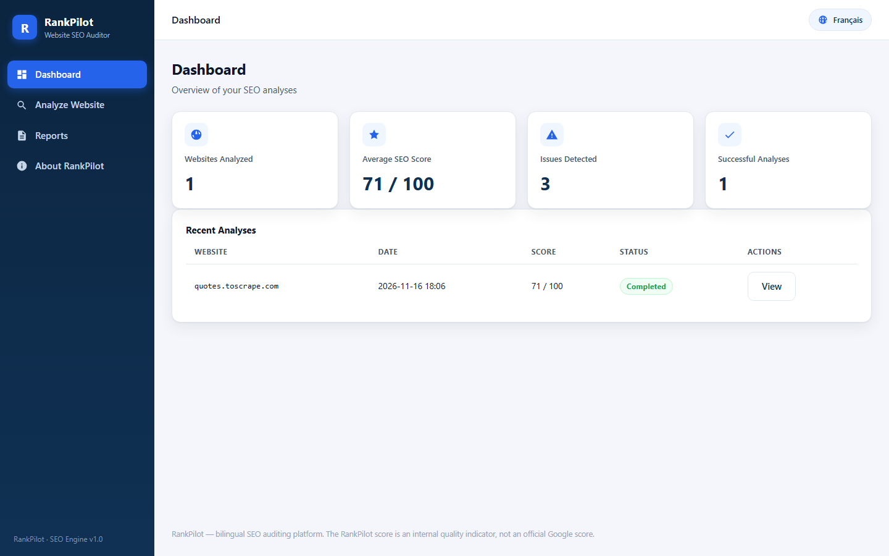
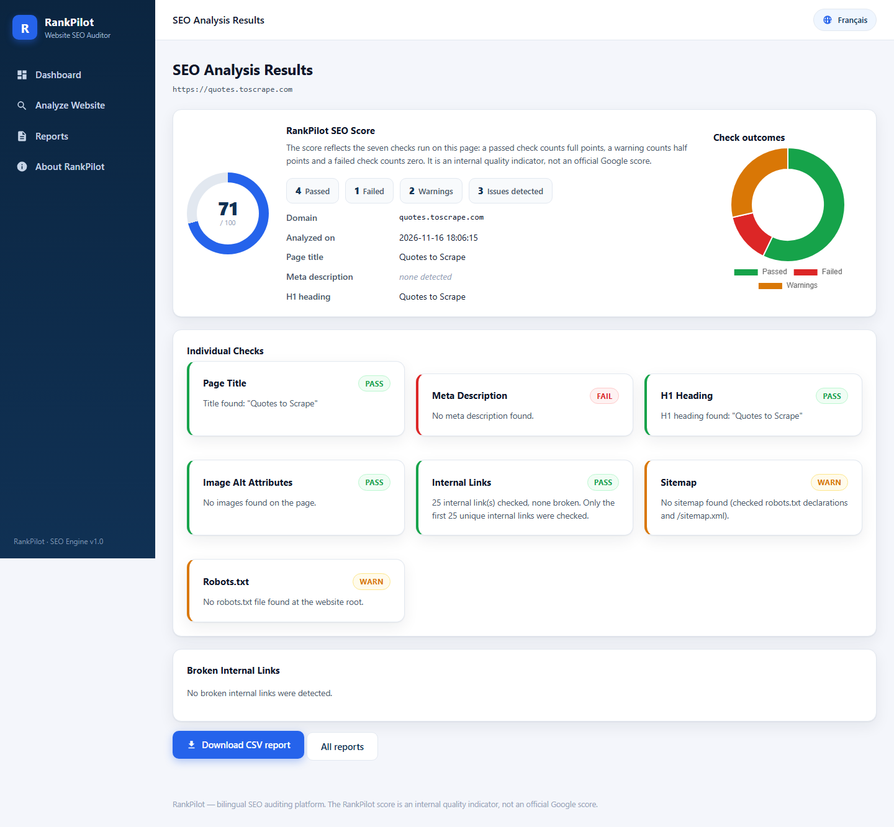
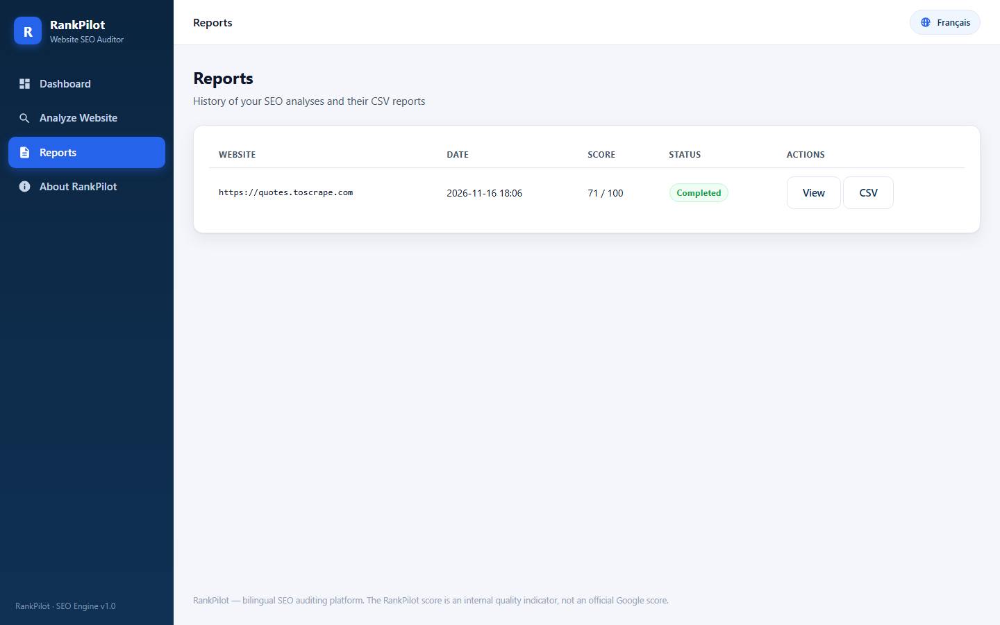

# RankPilot — Website SEO Auditor

**Français : [README_FR.md](README_FR.md)**

RankPilot is a bilingual (English / French) Python SEO auditing platform. It analyzes a website's on-page SEO through seven concrete checks and presents the results through **two interfaces built on the same analysis engine**:

1. A **command-line interface** for fast, scriptable audits with CSV reports.
2. A **Django web application** with a dashboard, an analyzer page, detailed result pages, report history and CSV downloads.

The RankPilot score is an internal quality indicator computed from the checks below. It is **not** an official Google score and does not predict Google rankings.

---

## Features

- **Seven SEO checks** on any public `http://` / `https://` URL:
  1. Page title
  2. Meta description
  3. H1 heading
  4. Image alt attributes (missing vs. intentionally empty alt text are distinguished)
  5. Broken internal links (HEAD requests with GET fallback, redirect handling, duplicate-link detection, fragment removal, `mailto:`/`tel:`/`javascript:`/`data:` exclusion, bounded link count)
  6. Sitemap availability (robots.txt declarations and `/sitemap.xml`)
  7. robots.txt availability
- **Transparent SEO score out of 100** computed from the actual check results.
- **Bilingual everywhere**: the CLI (`--lang en` / `--lang fr`) and the complete web interface (navigation, forms, results, reports, errors, empty states) with a session-persisted language switch.
- **CSV reports** written to `reports/` by the CLI and downloadable per analysis from the web interface (UTF-8 with BOM for Excel compatibility).
- **Analysis history** stored in SQLite through the Django ORM, surviving restarts.
- **Dashboard statistics** computed from stored analyses only (websites analyzed, average score, issues detected, successful analyses).
- **SSRF-hardened fetching**: private, loopback, link-local and reserved addresses are rejected, DNS results are validated before connecting, every redirect hop is re-validated, and responses are size-capped and time-limited.
- **Professional responsive web UI**: navy/blue design system, sidebar navigation, statistic cards, circular score visualization and a Chart.js outcome chart.
- **Test suite**: 81 automated tests (56 for the SEO engine and CLI, 25 for the Django application), all running offline with mocked HTTP.

## Technologies

| Layer     | Technology                                                    |
|-----------|---------------------------------------------------------------|
| Language  | Python 3.11+ (developed and tested on Python 3.14)            |
| Web frame | Django 5.2+ (tested on Django 6.1), Django templates          |
| HTTP      | `requests`, `beautifulsoup4`                                  |
| Database  | SQLite via the Django ORM (`JSONField` for structured results)|
| Frontend  | HTML5, CSS3, vanilla JavaScript, Chart.js (results chart)     |
| Testing   | `pytest`, `pytest-django`                                     |

No Flask, no Node.js, no MongoDB, no paid APIs.

## Screenshots

### Web interface

| Dashboard (English) | Dashboard (French) |
|---|---|
|  |  |

| Analyzer | Results |
|---|---|
|  |  |

| Reports |
|---|
|  |

### Command-line interface

| English output | French output |
|---|---|
|  |  |

| CSV report |
|---|
|  |

## Installation (Windows / PowerShell)

Requirements: Python 3.11 or newer and Git.

```powershell
# 1. Clone the repository
git clone https://github.com/yasser-dev-code/rankpilot-seo-auditor.git
cd rankpilot-seo-auditor

# 2. Create and activate a virtual environment
python -m venv .venv
.\.venv\Scripts\Activate.ps1

# 3. Install the dependencies
pip install -r requirements.txt

# 4. Create the SQLite database used by the web application
python web/manage.py migrate

# 5. Start the Django development server
python web/manage.py runserver
```

Then open <http://127.0.0.1:8000/> in your browser.

> If PowerShell blocks script execution, run
> `Set-ExecutionPolicy -Scope CurrentUser -ExecutionPolicy RemoteSigned` once, or activate the
> environment with `.venv\Scripts\activate.bat` from `cmd.exe`.

## Using the web interface

1. **Dashboard** (`/`) — overview statistics and the most recent analyses, or a guided empty state when no analysis exists yet.
2. **Analyze Website** (`/analyze/`) — enter a full `http://` or `https://` URL and submit. The existing Python SEO engine runs the audit, the result is stored, and you are redirected to the results page.
3. **Results** (`/results/<id>/`) — score ring out of 100, passed/failed/warning counters, detected page title, meta description and H1, one card per check with its status and explanation, a broken-links table and a **Download CSV report** button.
4. **Reports** (`/reports/`) — paginated history of every analysis with date, score, status, a link to the full results and a CSV download.
5. **Language switch** — the button in the top bar toggles English ⇄ French for the whole session; stored analyses are re-rendered in the active language.
6. **About RankPilot** (`/about/`) — scoring rules, security notes and version information.

## Using the CLI

```powershell
# One-shot audit (English)
python main.py --url https://example.com --lang en

# One-shot audit (French)
python main.py --url https://example.com --lang fr

# Interactive mode: prompts for the URL and language
python main.py
```

Each run prints a formatted bilingual report to the terminal and writes a CSV report to `reports/seo-report-<domain>-<timestamp>.csv`.

## SEO scoring methodology

Every audit runs the seven checks listed above. Each counted check contributes to the score:

| Status | Points |
|--------|--------|
| PASS   | 1.0    |
| WARN   | 0.5    |
| FAIL   | 0.0    |

`score = round(100 × earned points ÷ 7)`

A check is a **WARN** when the situation is recoverable or informational (for example a missing sitemap or robots.txt, or many images without alt text) and a **FAIL** when an expected element is absent or broken. The page-load line shown in reports is informational and is not counted. The score is a transparent internal indicator of the checks RankPilot performed — it is not an official Google score and makes no ranking prediction.

## CSV reports

- Written by the CLI to `reports/` and downloadable from every successful web analysis.
- Encoded as **UTF-8 with BOM** so Excel opens accented French text correctly.
- One row per check with status and details, plus one row per broken internal link (URL, HTTP status, error), so broken links are individually identifiable in spreadsheet tools.

## Project structure

```
rankpilot-seo-auditor/
├── main.py                  # CLI entry point (python main.py --url ... --lang ...)
├── rankpilot/               # Shared SEO engine used by CLI and web app
│   ├── analyzer.py          # Orchestrates the seven checks
│   ├── checks.py            # Individual check implementations + CheckResult
│   ├── link_checker.py      # Internal link extraction and broken-link probing
│   ├── reporter.py          # Terminal report + CSV rows/writer
│   ├── i18n.py              # Engine translation catalogue (en/fr)
│   └── utils.py             # URL normalization/validation helpers
├── web/                     # Django project
│   ├── manage.py
│   ├── config/              # Settings, root URLconf, WSGI/ASGI
│   ├── auditor/             # Django app: models, views, services, security, translations
│   │   ├── models.py        # Analysis model (SQLite + JSONField)
│   │   ├── services.py      # Bridges the web app to the shared engine, scoring
│   │   ├── security.py      # SSRF-safe session and public-URL validation
│   │   └── translations.py  # Web UI translation catalogue (en/fr)
│   ├── templates/           # base, dashboard, analyzer, results, reports, about
│   └── static/              # CSS design system + JavaScript
├── tests/                   # 56 engine/CLI tests + 25 Django tests
├── docs/screenshots/        # CLI and web screenshots
├── reports/                 # Generated CSV reports (gitignored)
├── requirements.txt
├── pytest.ini
├── README.md
└── README_FR.md
```

## Testing

All tests run offline; external HTTP traffic is mocked.

```powershell
# Full suite (engine + CLI + Django)
pytest

# Django system checks
python web/manage.py check

# Migration consistency
python web/manage.py makemigrations --check --dry-run
python web/manage.py migrate
```

Current status: **81 tests passing** (56 engine/CLI, 25 Django), `manage.py check` clean, no pending migrations.

## Security considerations

- Only `http` and `https` URLs are accepted; anything else is rejected before any request is made.
- Hostnames are resolved with `socket.getaddrinfo` and every resolved address must be a global public IP — loopback, private, link-local and reserved ranges (including cloud metadata endpoints) are blocked, which prevents SSRF through the auditor.
- The custom `SSRFSafeSession` re-validates **every** request, including each redirect hop, so a public site cannot redirect RankPilot onto an internal service.
- Requests carry timeouts and responses are streamed with a 5 MiB hard cap.
- Internal link checking is bounded (first 25 unique internal links) to keep audits polite and fast.
- Django CSRF protection is enabled on all POST forms; templates escape all output; CSV downloads are generated in memory with safe filenames.
- The development server binds to localhost only. The bundled settings are for development; a real deployment needs production settings (`DEBUG=False`, a secret key from the environment, TLS, hardened `ALLOWED_HOSTS`).

## Current limitations

- Analyses run synchronously inside the request/response cycle, so very large sites can make the analyzer page wait.
- Only the landing page of a website is audited (plus its internal links for availability).
- JavaScript-rendered content is not executed; only the served HTML is parsed.
- SQLite is intended for local use, not concurrent production traffic.
- The web interface has no authentication; it is a single-user local tool.

## Future improvements

- Background task queue (e.g. Celery or Django management commands) for long audits.
- Multi-page crawls with per-page scores and site-wide summaries.
- User accounts with private analysis history.
- PDF export and scheduled re-audits with score trend charts.
- Additional checks (Open Graph tags, canonical URLs, hreflang, page weight).

---

RankPilot — portfolio project by Yasser · Built with Python, Django and care.
