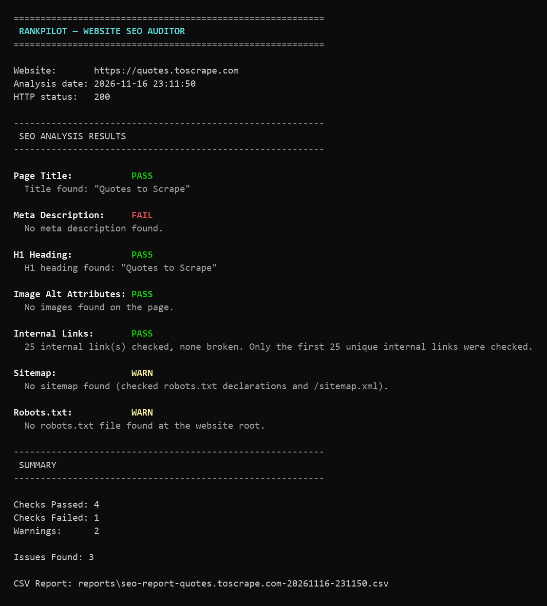
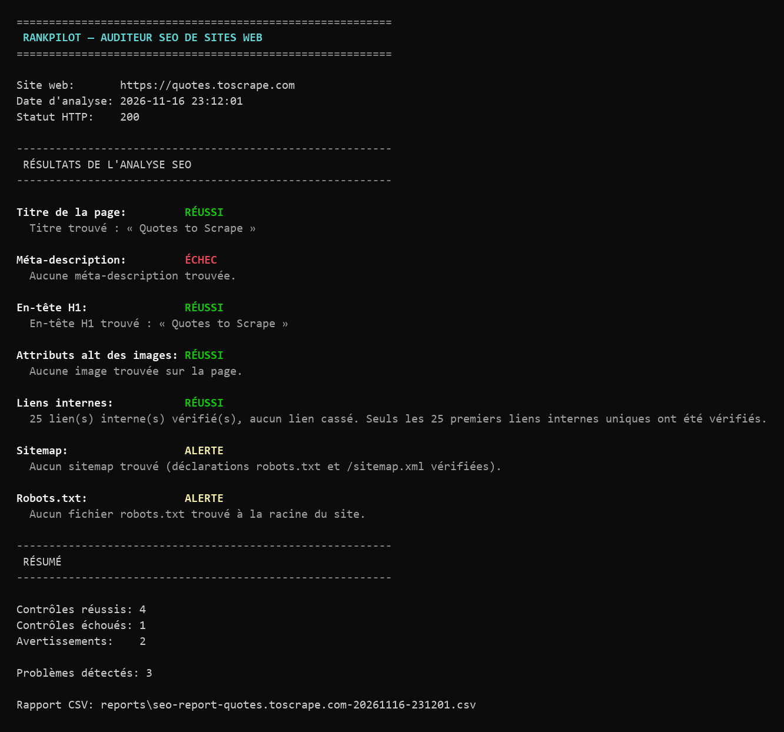
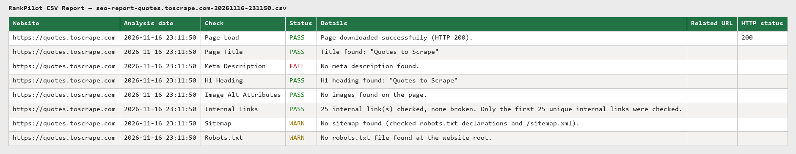

# RankPilot — Website SEO Auditor

**French documentation: [README_FR.md](README_FR.md)**

RankPilot is a bilingual (English / French) Python command-line application that
analyzes a website for common SEO problems, displays a clean professional report
in the terminal, and generates a CSV report for every analysis.

Give RankPilot a URL and it downloads the page, runs seven SEO checks, verifies
the internal links, looks for a sitemap and a `robots.txt` file, and tells you
exactly what to fix.

---

## Project purpose

Small and medium websites frequently ship without a meta description, without
alt attributes on images, or with broken internal links — problems that hurt
their search engine rankings. RankPilot makes these problems visible in seconds,
from a single terminal command, without any setup beyond Python and two
lightweight libraries.

## Main features

- **Seven SEO checks** on the analyzed page:
  1. **Page Title** — present and non-empty.
  2. **Meta Description** — present and non-empty.
  3. **H1 Heading** — at least one H1 (multiple H1s raise a warning).
  4. **Image Alt Attributes** — missing `alt` fails; empty `alt` only warns,
     because it can be intentional for decorative images.
  5. **Broken Internal Links** — internal links are resolved, deduplicated and
     checked over HTTP (HEAD first, GET fallback). Broken URLs are listed with
     their HTTP status or error.
  6. **Sitemap** — declared in `robots.txt` or available at `/sitemap.xml`.
  7. **Robots.txt** — present at the website root.
- **Fully bilingual interface** — `--lang en` (default) and `--lang fr`,
  including terminal output, error messages, command-line help and CSV reports.
- **CSV reports** — one report per analysis in `reports/`, named after the
  website and a timestamp, written as UTF-8 with BOM so French text opens
  correctly in Microsoft Excel. Broken links appear as identifiable rows.
- **Professional terminal output** — PASS / FAIL / WARN statuses, per-check
  details, a summary of issues and the report location.
- **Interactive mode** — start RankPilot without `--url` and it asks for the URL.
- **Robust input handling** — URL validation (HTTPS assumed when no scheme is
  given, only HTTP/HTTPS accepted), request timeouts, and graceful handling of
  inaccessible websites, timeouts and malformed HTML.

## Technologies used

| Technology      | Role                          |
|-----------------|-------------------------------|
| Python 3        | Application language          |
| Requests        | HTTP requests                 |
| BeautifulSoup4  | HTML parsing                  |
| csv (stdlib)    | CSV report generation         |
| Pytest          | Automated testing             |

## Screenshots

### English terminal analysis



### French terminal analysis



### CSV report



## Installation

Requirements: Python 3.9 or newer and Git.

```bash
git clone https://github.com/yasser-dev-code/rankpilot-seo-auditor.git
cd rankpilot-seo-auditor

python -m venv .venv
# Windows:
.venv\Scripts\activate
# macOS / Linux:
source .venv/bin/activate

pip install -r requirements.txt
```

## How to run

Analyze a website in English (default):

```bash
python main.py --url https://example.com --lang en
```

Analyze a website in French:

```bash
python main.py --url https://example.com --lang fr
```

Show the localized command-line help:

```bash
python main.py --help
```

Start in interactive mode (RankPilot asks for the URL):

```bash
python main.py
```

Useful options:

| Option          | Description                                        | Default   |
|-----------------|----------------------------------------------------|-----------|
| `--url`         | Website URL to analyze                             | *(interactive mode)* |
| `--lang`        | Interface language: `en` or `fr`                   | `en`      |
| `--timeout`     | Request timeout in seconds                         | `10`      |
| `--reports-dir` | Directory where CSV reports are saved              | `reports` |

### Example terminal result

Real output of `python main.py --url https://quotes.toscrape.com --lang en`:

```text
==========================================================
 RANKPILOT — WEBSITE SEO AUDITOR
==========================================================

Website:       https://quotes.toscrape.com
Analysis date: 2026-11-16 23:11:50
HTTP status:   200

----------------------------------------------------------
 SEO ANALYSIS RESULTS
----------------------------------------------------------

Page Title:           PASS
  Title found: "Quotes to Scrape"

Meta Description:     FAIL
  No meta description found.

H1 Heading:           PASS
  H1 heading found: "Quotes to Scrape"

Image Alt Attributes: PASS
  No images found on the page.

Internal Links:       PASS
  25 internal link(s) checked, none broken. Only the first 25 unique internal links were checked.

Sitemap:              WARN
  No sitemap found (checked robots.txt declarations and /sitemap.xml).

Robots.txt:           WARN
  No robots.txt file found at the website root.

----------------------------------------------------------
 SUMMARY
----------------------------------------------------------

Checks Passed: 4
Checks Failed: 1
Warnings:      2

Issues Found: 3

CSV Report: reports\seo-report-quotes.toscrape.com-20261116-231150.csv
```

## CSV reports

Every successful analysis writes a CSV report into `reports/`, for example
`reports/seo-report-quotes.toscrape.com-20261116-231150.csv`.

The report contains one row per check, plus one identifiable row per broken
internal link, with these columns:

| Column        | Content                                            |
|---------------|----------------------------------------------------|
| Website       | The analyzed URL                                   |
| Analysis date | Date and time of the analysis                      |
| Check         | Check name (localized)                             |
| Status        | PASS / FAIL / WARN (localized: RÉUSSI / ÉCHEC / ALERTE) |
| Details       | Human-readable explanation of the result           |
| Related URL   | The URL concerned, where applicable (broken links) |
| HTTP status   | The HTTP status code, where applicable             |

Reports are encoded as UTF-8 with BOM, so accented French text displays
correctly when opened in Microsoft Excel. Generated reports are ignored by Git.

## Project structure

```text
rankpilot-seo-auditor/
│
├── rankpilot/
│   ├── __init__.py        # Package metadata and version
│   ├── analyzer.py        # Orchestrates the download and the seven checks
│   ├── checks.py          # Individual SEO checks (title, meta, H1, images, ...)
│   ├── link_checker.py    # Internal link extraction and HTTP verification
│   ├── reporter.py        # CSV report generation (UTF-8 with BOM)
│   ├── i18n.py            # English and French translations
│   └── utils.py           # URL validation and HTTP helpers
│
├── tests/
│   ├── test_analyzer.py   # End-to-end audits with mocked HTTP + CLI output
│   ├── test_checks.py     # The seven SEO checks
│   ├── test_link_checker.py # Link extraction and broken-link detection
│   ├── test_reporter.py   # CSV validity, BOM and broken-link rows
│   └── test_utils.py      # URL validation
│
├── reports/               # Generated CSV reports (not committed)
├── docs/
│   └── screenshots/       # Terminal and CSV screenshots
│
├── main.py                # Command-line entry point
├── requirements.txt
├── .gitignore
├── README.md
└── README_FR.md
```

## Automated testing

The test suite uses Pytest with mocked HTTP responses, so it runs without
internet access:

```bash
pytest tests/ -v
```

55 tests cover the seven checks, internal-link identification and broken-link
detection, sitemap and robots.txt detection, CSV report generation (including
the UTF-8 BOM), URL validation, and both English and French terminal output.

## Current limitations

- One page is analyzed per execution (by design for version 1).
- Internal link checking is capped at the first 25 unique links per page to
  stay fast and polite to the target website.
- Only static HTML is analyzed; content rendered by JavaScript is not seen.
- Checks are limited to the seven implemented SEO rules.

## Possible future improvements

- Crawl up to ten pages per execution with the existing architecture.
- Additional checks: canonical URL, Open Graph tags, heading hierarchy,
  page weight and response time.
- HTML or JSON report formats in addition to CSV.
- Configuration file for per-site thresholds and ignored URLs.

---

RankPilot is a portfolio project built to demonstrate clean, tested,
well-documented Python engineering.
