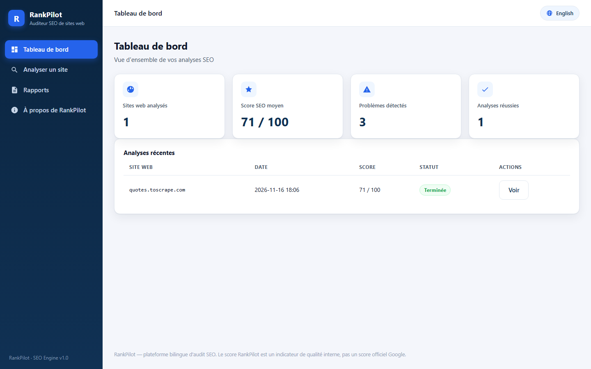
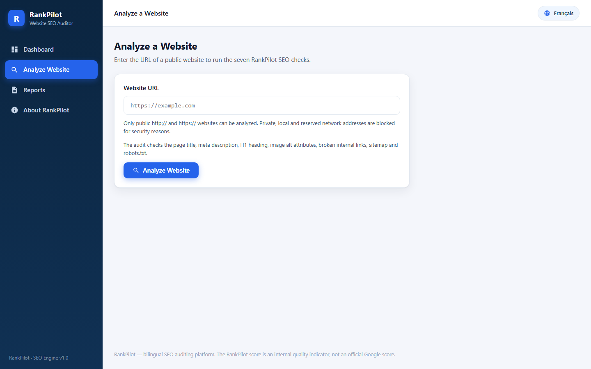
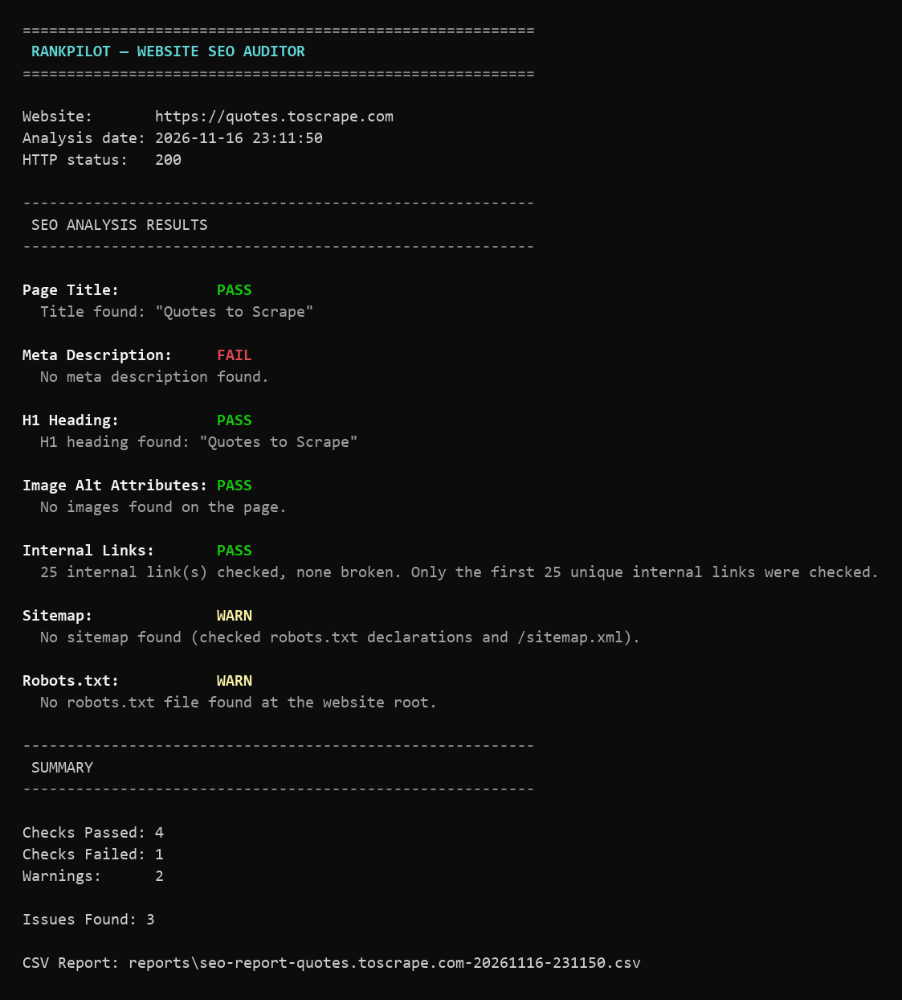

# RankPilot — Auditeur SEO de sites web

**English : [README.md](README.md)**

RankPilot est une plateforme d'audit SEO bilingue (anglais / français) écrite en Python. Elle analyse le SEO on-page d'un site web à travers sept contrôles concrets et présente les résultats via **deux interfaces reposant sur le même moteur d'analyse** :

1. Une **interface en ligne de commande** pour des audits rapides et scriptables, avec rapports CSV.
2. Une **application web Django** avec tableau de bord, page d'analyse, pages de résultats détaillés, historique des rapports et téléchargements CSV.

Le score RankPilot est un indicateur de qualité interne calculé à partir des contrôles ci-dessous. Ce n'est **pas** un score officiel Google et il ne prédit pas le classement Google.

---

## Fonctionnalités

- **Sept contrôles SEO** sur toute URL publique `http://` / `https://` :
  1. Titre de la page
  2. Méta-description
  3. Balise H1
  4. Attributs alt des images (les alt manquants et les alt volontairement vides sont distingués)
  5. Liens internes cassés (requêtes HEAD avec repli GET, gestion des redirections, détection des doublons, suppression des fragments, exclusion de `mailto:`/`tel:`/`javascript:`/`data:`, nombre de liens limité)
  6. Présence du sitemap (déclarations du robots.txt et `/sitemap.xml`)
  7. Présence du robots.txt
- **Score SEO transparent sur 100** calculé à partir des résultats réels des contrôles.
- **Bilingue partout** : la CLI (`--lang en` / `--lang fr`) et l'interface web complète (navigation, formulaires, résultats, rapports, erreurs, états vides) avec un changement de langue persistant pour la session.
- **Rapports CSV** écrits dans `reports/` par la CLI et téléchargeables par analyse depuis l'interface web (UTF-8 avec BOM pour la compatibilité Excel).
- **Historique des analyses** stocké en SQLite via l'ORM Django, conservé après redémarrage.
- **Statistiques du tableau de bord** calculées uniquement à partir des analyses enregistrées (sites analysés, score moyen, problèmes détectés, analyses réussies).
- **Protection SSRF** : les adresses privées, loopback, link-local et réservées sont rejetées, les résolutions DNS sont validées avant connexion, chaque saut de redirection est re-validé, et les réponses sont limitées en taille et en durée.
- **Interface web professionnelle et responsive** : design system navy/bleu, navigation latérale, cartes de statistiques, visualisation circulaire du score et graphique Chart.js.
- **Suite de tests** : 81 tests automatisés (56 pour le moteur SEO et la CLI, 25 pour l'application Django), tous exécutés hors ligne avec HTTP simulé.

## Technologies

| Couche    | Technologie                                                      |
|-----------|------------------------------------------------------------------|
| Langage   | Python 3.11+ (développé et testé sur Python 3.14)                |
| Framework | Django 5.2+ (testé sur Django 6.1), templates Django             |
| HTTP      | `requests`, `beautifulsoup4`                                     |
| Base de données | SQLite via l'ORM Django (`JSONField` pour les résultats structurés) |
| Frontend  | HTML5, CSS3, JavaScript vanilla, Chart.js (graphique des résultats) |
| Tests     | `pytest`, `pytest-django`                                        |

Pas de Flask, pas de Node.js, pas de MongoDB, pas d'API payantes.

## Captures d'écran

### Interface web

| Tableau de bord (anglais) | Tableau de bord (français) |
|---|---|
|  |  |

| Analyseur | Résultats |
|---|---|
|  |  |

| Rapports |
|---|
|  |

### Interface en ligne de commande

| Sortie anglaise | Sortie française |
|---|---|
|  |  |

| Rapport CSV |
|---|
|  |

## Installation (Windows / PowerShell)

Prérequis : Python 3.11 ou plus récent et Git.

```powershell
# 1. Cloner le dépôt
git clone https://github.com/yasser-dev-code/rankpilot-seo-auditor.git
cd rankpilot-seo-auditor

# 2. Créer et activer un environnement virtuel
python -m venv .venv
.\.venv\Scripts\Activate.ps1

# 3. Installer les dépendances
pip install -r requirements.txt

# 4. Créer la base SQLite utilisée par l'application web
python web/manage.py migrate

# 5. Démarrer le serveur de développement Django
python web/manage.py runserver
```

Ouvrir ensuite <http://127.0.0.1:8000/> dans le navigateur.

> Si PowerShell bloque l'exécution des scripts, exécuter une fois
> `Set-ExecutionPolicy -Scope CurrentUser -ExecutionPolicy RemoteSigned`, ou activer
> l'environnement avec `.venv\Scripts\activate.bat` depuis `cmd.exe`.

## Utiliser l'interface web

1. **Tableau de bord** (`/`) — statistiques globales et analyses récentes, ou un état vide guidé lorsqu'aucune analyse n'existe encore.
2. **Analyser un site** (`/analyze/`) — saisir une URL complète `http://` ou `https://` puis valider. Le moteur SEO Python existant exécute l'audit, le résultat est enregistré, puis vous êtes redirigé vers la page de résultats.
3. **Résultats** (`/results/<id>/`) — anneau de score sur 100, compteurs succès/échecs/avertissements, titre de page, méta-description et H1 détectés, une carte par contrôle avec son statut et son explication, tableau des liens cassés et bouton **Télécharger le rapport CSV**.
4. **Rapports** (`/reports/`) — historique paginé de toutes les analyses avec date, score, statut, lien vers les résultats complets et téléchargement CSV.
5. **Changement de langue** — le bouton en haut de page bascule anglais ⇄ français pour toute la session ; les analyses enregistrées sont réaffichées dans la langue active.
6. **À propos de RankPilot** (`/about/`) — règles de score, notes de sécurité et informations de version.

## Utiliser la CLI

```powershell
# Audit ponctuel (anglais)
python main.py --url https://example.com --lang en

# Audit ponctuel (français)
python main.py --url https://example.com --lang fr

# Mode interactif : demande l'URL et la langue
python main.py
```

Chaque exécution affiche un rapport formaté bilingue dans le terminal et écrit un rapport CSV dans `reports/seo-report-<domaine>-<horodatage>.csv`.

## Méthode de calcul du score SEO

Chaque audit exécute les sept contrôles listés ci-dessus. Chaque contrôle comptabilisé contribue au score :

| Statut | Points |
|--------|--------|
| PASS   | 1,0    |
| WARN   | 0,5    |
| FAIL   | 0,0    |

`score = arrondi(100 × points obtenus ÷ 7)`

Un contrôle est en **WARN** lorsque la situation est rattrapable ou informative (par exemple sitemap ou robots.txt absent, ou nombreuses images sans alt) et en **FAIL** lorsqu'un élément attendu est absent ou cassé. La ligne de chargement de page affichée dans les rapports est informative et n'est pas comptabilisée. Le score est un indicateur interne transparent des contrôles effectués par RankPilot — ce n'est pas un score officiel Google et il ne prédit aucun classement.

## Rapports CSV

- Écrits par la CLI dans `reports/` et téléchargeables depuis chaque analyse web réussie.
- Encodés en **UTF-8 avec BOM** afin qu'Excel ouvre correctement les accents français.
- Une ligne par contrôle avec statut et détails, plus une ligne par lien interne cassé (URL, statut HTTP, erreur), ce qui rend chaque lien cassé identifiable individuellement dans un tableur.

## Structure du projet

```
rankpilot-seo-auditor/
├── main.py                  # Point d'entrée CLI (python main.py --url ... --lang ...)
├── rankpilot/               # Moteur SEO partagé par la CLI et l'application web
│   ├── analyzer.py          # Orchestre les sept contrôles
│   ├── checks.py            # Implémentations des contrôles + CheckResult
│   ├── link_checker.py      # Extraction des liens internes et détection des liens cassés
│   ├── reporter.py          # Rapport terminal + lignes/écriture CSV
│   ├── i18n.py              # Catalogue de traductions du moteur (en/fr)
│   └── utils.py             # Normalisation/validation des URL
├── web/                     # Projet Django
│   ├── manage.py
│   ├── config/              # Settings, URLconf racine, WSGI/ASGI
│   ├── auditor/             # App Django : modèles, vues, services, sécurité, traductions
│   │   ├── models.py        # Modèle Analysis (SQLite + JSONField)
│   │   ├── services.py      # Pont entre l'application web et le moteur partagé, score
│   │   ├── security.py      # Session anti-SSRF et validation des URL publiques
│   │   └── translations.py  # Catalogue de traductions de l'interface web (en/fr)
│   ├── templates/           # base, dashboard, analyzer, results, reports, about
│   └── static/              # Design system CSS + JavaScript
├── tests/                   # 56 tests moteur/CLI + 25 tests Django
├── docs/screenshots/        # Captures CLI et web
├── reports/                 # Rapports CSV générés (ignorés par git)
├── requirements.txt
├── pytest.ini
├── README.md
└── README_FR.md
```

## Tests

Tous les tests s'exécutent hors ligne ; le trafic HTTP externe est simulé.

```powershell
# Suite complète (moteur + CLI + Django)
pytest

# Vérifications système Django
python web/manage.py check

# Cohérence des migrations
python web/manage.py makemigrations --check --dry-run
python web/manage.py migrate
```

État actuel : **81 tests réussis** (56 moteur/CLI, 25 Django), `manage.py check` sans erreur, aucune migration en attente.

## Considérations de sécurité

- Seules les URL `http` et `https` sont acceptées ; toute autre valeur est rejetée avant la moindre requête.
- Les noms de domaine sont résolus avec `socket.getaddrinfo` et chaque adresse résolue doit être une IP publique globale — les plages loopback, privées, link-local et réservées (y compris les points de métadonnées cloud) sont bloquées, ce qui empêche toute SSRF via l'auditeur.
- La session personnalisée `SSRFSafeSession` re-valide **chaque** requête, y compris chaque saut de redirection : un site public ne peut donc pas rediriger RankPilot vers un service interne.
- Les requêtes portent des délais d'attente et les réponses sont lues en flux avec une limite stricte de 5 Mio.
- La vérification des liens internes est bornée (25 premiers liens internes uniques) pour rester courtois et rapide.
- La protection CSRF de Django est active sur tous les formulaires POST ; les templates échappent toutes les sorties ; les téléchargements CSV sont générés en mémoire avec des noms de fichier sûrs.
- Le serveur de développement écoute uniquement sur localhost. Les settings fournis sont destinés au développement ; un déploiement réel exige des settings de production (`DEBUG=False`, clé secrète via l'environnement, TLS, `ALLOWED_HOSTS` durci).

## Limitations actuelles

- Les analyses s'exécutent de façon synchrone dans le cycle requête/réponse : un site très volumineux peut faire attendre la page d'analyse.
- Seule la page d'accueil du site est auditée (plus la disponibilité de ses liens internes).
- Le contenu rendu par JavaScript n'est pas exécuté ; seul le HTML servi est analysé.
- SQLite est prévu pour un usage local, pas pour un trafic de production concurrent.
- L'interface web n'a pas d'authentification ; c'est un outil local mono-utilisateur.

## Améliorations futures

- File de tâches en arrière-plan (ex. Celery ou commandes de management Django) pour les audits longs.
- Explorations multi-pages avec scores par page et synthèses à l'échelle du site.
- Comptes utilisateurs avec historique d'analyses privé.
- Export PDF et ré-audits planifiés avec courbes d'évolution du score.
- Contrôles supplémentaires (balises Open Graph, URL canoniques, hreflang, poids de page).

---

RankPilot — projet portfolio par Yasser · Construit avec Python, Django et soin.
