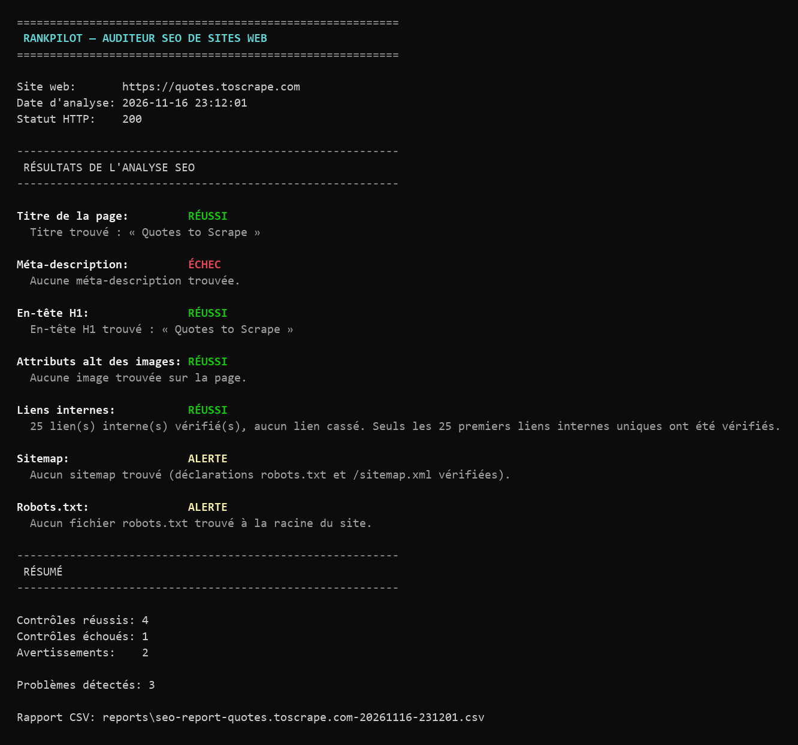
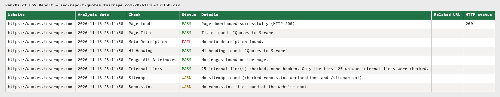

# RankPilot — Auditeur SEO de sites web

**Documentation anglaise : [README.md](README.md)**

RankPilot est une application Python en ligne de commande, entièrement bilingue
(français / anglais), qui analyse un site web pour détecter les problèmes SEO
courants, affiche un rapport clair et professionnel dans le terminal et génère
un rapport CSV à chaque analyse.

Donnez une URL à RankPilot : il télécharge la page, exécute sept contrôles SEO,
vérifie les liens internes, recherche un sitemap et un fichier `robots.txt`,
puis vous indique précisément ce qu'il faut corriger.

---

## Objectif du projet

Les petits et moyens sites web sont fréquemment publiés sans méta-description,
sans attribut alt sur les images, ou avec des liens internes cassés — autant de
problèmes qui pénalisent leur positionnement dans les moteurs de recherche.
RankPilot rend ces problèmes visibles en quelques secondes, depuis une simple
commande, sans autre prérequis que Python et deux bibliothèques légères.

## Fonctionnalités principales

- **Sept contrôles SEO** sur la page analysée :
  1. **Titre de la page** — présent et non vide.
  2. **Méta-description** — présente et non vide.
  3. **En-tête H1** — au moins un H1 (plusieurs H1 déclenchent une alerte).
  4. **Attributs alt des images** — un `alt` manquant est un échec ; un `alt`
     vide déclenche seulement une alerte, car il peut être intentionnel pour
     les images décoratives.
  5. **Liens internes cassés** — les liens internes sont résolus, dédupliqués et
     vérifiés en HTTP (HEAD d'abord, repli sur GET). Les URL cassées sont
     listées avec leur statut HTTP ou leur erreur.
  6. **Sitemap** — déclaré dans `robots.txt` ou disponible à `/sitemap.xml`.
  7. **Robots.txt** — présent à la racine du site.
- **Interface entièrement bilingue** — `--lang fr` et `--lang en` (par défaut),
  y compris la sortie terminal, les messages d'erreur, l'aide en ligne de
  commande et les rapports CSV.
- **Rapports CSV** — un rapport par analyse dans `reports/`, nommé d'après le
  site et un horodatage, écrit en UTF-8 avec BOM afin que les accents français
  s'affichent correctement dans Microsoft Excel. Les liens cassés apparaissent
  sous forme de lignes identifiables.
- **Sortie terminal professionnelle** — statuts RÉUSSI / ÉCHEC / ALERTE,
  détails par contrôle, résumé des problèmes et emplacement du rapport.
- **Mode interactif** — lancez RankPilot sans `--url` : il demande l'URL.
- **Gestion robuste des entrées** — validation d'URL (HTTPS supposé en
  l'absence de schéma, seuls HTTP/HTTPS sont acceptés), délais d'expiration des
  requêtes, et traitement sans plantage des sites inaccessibles, des timeouts
  et du HTML mal formé.

## Technologies utilisées

| Technologie      | Rôle                              |
|------------------|-----------------------------------|
| Python 3         | Langage de l'application          |
| Requests         | Requêtes HTTP                     |
| BeautifulSoup4   | Analyse du HTML                   |
| csv (stdlib)     | Génération des rapports CSV       |
| Pytest           | Tests automatisés                 |

## Captures d'écran

### Analyse terminal en anglais


### Analyse terminal en français



### Rapport CSV



## Installation

Prérequis : Python 3.9 ou plus récent et Git.

```bash
git clone https://github.com/yasser-dev-code/rankpilot-seo-auditor.git
cd rankpilot-seo-auditor

python -m venv .venv
# Windows :
.venv\Scripts\activate
# macOS / Linux :
source .venv/bin/activate

pip install -r requirements.txt
```

## Utilisation

Analyser un site web en français :

```bash
python main.py --url https://example.com --lang fr
```

Analyser un site web en anglais (langue par défaut) :

```bash
python main.py --url https://example.com --lang en
```

Afficher l'aide en ligne de commande localisée :

```bash
python main.py --help
```

Démarrer en mode interactif (RankPilot demande l'URL) :

```bash
python main.py
```

Options disponibles :

| Option          | Description                                              | Défaut    |
|-----------------|----------------------------------------------------------|-----------|
| `--url`         | URL du site web à analyser                               | *(mode interactif)* |
| `--lang`        | Langue de l'interface : `fr` ou `en`                     | `en`      |
| `--timeout`     | Délai d'expiration des requêtes en secondes              | `10`      |
| `--reports-dir` | Répertoire d'enregistrement des rapports CSV           | `reports` |

### Exemple de résultat terminal

Sortie réelle de `python main.py --url https://quotes.toscrape.com --lang fr` :

```text
==========================================================
 RANKPILOT — AUDITEUR SEO DE SITES WEB
==========================================================

Site web:       https://quotes.toscrape.com
Date d'analyse: 2026-11-16 23:12:01
Statut HTTP:    200

----------------------------------------------------------
 RÉSULTATS DE L'ANALYSE SEO
----------------------------------------------------------

Titre de la page:         RÉUSSI
  Titre trouvé : « Quotes to Scrape »

Méta-description:         ÉCHEC
  Aucune méta-description trouvée.

En-tête H1:               RÉUSSI
  En-tête H1 trouvé : « Quotes to Scrape »

Attributs alt des images: RÉUSSI
  Aucune image trouvée sur la page.

Liens internes:           RÉUSSI
  25 lien(s) interne(s) vérifié(s), aucun lien cassé. Seuls les 25 premiers liens internes uniques ont été vérifiés.

Sitemap:                  ALERTE
  Aucun sitemap trouvé (déclarations robots.txt et /sitemap.xml vérifiées).

Robots.txt:               ALERTE
  Aucun fichier robots.txt trouvé à la racine du site.

----------------------------------------------------------
 RÉSUMÉ
----------------------------------------------------------

Contrôles réussis: 4
Contrôles échoués: 1
Avertissements:    2

Problèmes détectés: 3

Rapport CSV: reports\seo-report-quotes.toscrape.com-20261116-231201.csv
```

## Rapports CSV

Chaque analyse réussie écrit un rapport CSV dans `reports/`, par exemple
`reports/seo-report-quotes.toscrape.com-20261116-231201.csv`.

Le rapport contient une ligne par contrôle, ainsi qu'une ligne identifiable par
lien interne cassé, avec ces colonnes :

| Colonne       | Contenu                                                 |
|---------------|---------------------------------------------------------|
| Site web      | L'URL analysée                                          |
| Date d'analyse| Date et heure de l'analyse                              |
| Contrôle      | Nom du contrôle (localisé)                              |
| Statut        | RÉUSSI / ÉCHEC / ALERTE (PASS / FAIL / WARN en anglais) |
| Détails       | Explication lisible du résultat                         |
| URL associée  | L'URL concernée, le cas échéant (liens cassés)          |
| Statut HTTP   | Le code de statut HTTP, le cas échéant                  |

Les rapports sont encodés en UTF-8 avec BOM : les accents français s'affichent
donc correctement à l'ouverture dans Microsoft Excel. Les rapports générés sont
ignorés par Git.

## Structure du projet

```text
rankpilot-seo-auditor/
│
├── rankpilot/
│   ├── __init__.py        # Métadonnées du paquet et version
│   ├── analyzer.py        # Orchestre le téléchargement et les sept contrôles
│   ├── checks.py          # Contrôles SEO individuels (titre, méta, H1, images, ...)
│   ├── link_checker.py    # Extraction et vérification HTTP des liens internes
│   ├── reporter.py        # Génération des rapports CSV (UTF-8 avec BOM)
│   ├── i18n.py            # Traductions françaises et anglaises
│   └── utils.py           # Validation d'URL et helpers HTTP
│
├── tests/
│   ├── test_analyzer.py   # Audits de bout en bout avec HTTP simulé + sortie CLI
│   ├── test_checks.py     # Les sept contrôles SEO
│   ├── test_link_checker.py # Identification des liens et détection des liens cassés
│   ├── test_reporter.py   # Validité du CSV, BOM et lignes de liens cassés
│   └── test_utils.py      # Validation d'URL
│
├── reports/               # Rapports CSV générés (non commités)
├── docs/
│   └── screenshots/       # Captures du terminal et du rapport CSV
│
├── main.py                # Point d'entrée en ligne de commande
├── requirements.txt
├── .gitignore
├── README.md
└── README_FR.md
```

## Tests automatisés

La suite de tests utilise Pytest avec des réponses HTTP simulées : elle
s'exécute donc sans accès à Internet :

```bash
pytest tests/ -v
```

55 tests couvrent les sept contrôles, l'identification des liens internes et la
détection des liens cassés, la détection du sitemap et du robots.txt, la
génération du rapport CSV (y compris le BOM UTF-8), la validation d'URL, ainsi
que les sorties terminal en français et en anglais.

## Limitations actuelles

- Une seule page est analysée par exécution (choix de conception de la version 1).
- La vérification des liens internes est limitée aux 25 premières URL uniques
  par page, afin de rester rapide et respectueuse du site cible.
- Seul le HTML statique est analysé ; le contenu rendu par JavaScript n'est pas
  visible.
- Les contrôles se limitent aux sept règles SEO implémentées.

## Améliorations futures possibles

- Explorer jusqu'à dix pages par exécution avec l'architecture existante.
- Contrôles supplémentaires : URL canonique, balises Open Graph, hiérarchie des
  titres, poids de la page et temps de réponse.
- Formats de rapport HTML ou JSON en complément du CSV.
- Fichier de configuration pour les seuils par site et les URL ignorées.

---

RankPilot est un projet de portfolio conçu pour démontrer une ingénierie Python
propre, testée et soigneusement documentée.
